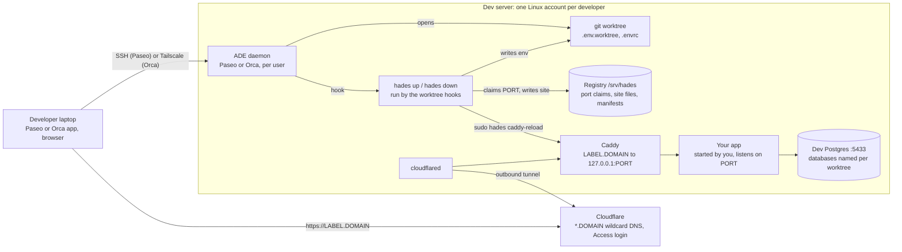

# Hades

Host for ADEs: a shared Linux dev server for agentic development environments, and the CLI that
runs on it.

Each developer has their own account, their own agentic development environment (ADE:
[Paseo](https://getpaseo.com) or [Orca](https://github.com/stablyai/orca)) running as a daemon, and
their own git worktrees. Every web worktree gets its own port, database names, environment file and
a URL behind a login. The CLI, `hades`, is what the ADE's worktree hooks call; it also works alone on
a laptop. The Ansible collection `quotedo.hades` builds and runs the server.

A worktree's URL is `https://<label>.<domain>`; the [CLI reference](docs/cli.md#commands) defines
the label.

## What you get

- One Linux account per developer, with its own ADE daemon, CPU and memory slice, and git worktrees.
- Per worktree: a port, database names, a RabbitMQ vhost, `.env.worktree` and `.envrc` (direnv), written by `hades up` and removed by `hades down`.
- A public URL per worktree, `https://<label>.<domain>`, through a Cloudflare tunnel and behind Cloudflare Access: email one-time PIN, 30-day sessions, an allow-list you edit in the inventory.
- MCP entries written into the worktree's agent configs: Tidewave at the worktree's port for Phoenix projects, chrome-devtools with a Chrome for Testing on the box.
- A shared toolchain store (Erlang, Elixir, Node, Python, Go, kubectl, gh) pinned to exact versions in the inventory; the agent CLIs (Claude Code, Codex, Paseo, Orca) installed once for everyone.
- Dev Postgres, RabbitMQ and LocalStack on loopback, with nftables rules so no account reaches another account's ports.
- Developer onboarding in one laptop command, `hades join <host>`: SSH keys from GitHub, refreshed hourly; a first-login script that logs the developer into GitHub and the agent CLIs and prints the Paseo Desktop address.
- Offboarding by `state: absent`: the account, its worktrees, ports and databases go; the home is archived.
- Optional: an intranet VPN (AmneziaWG) for the whole box, Tailscale for Orca pairing and node sharing.
- The same CLI works alone on a laptop against a local Postgres, without the server.



## Quick start: developer

1. Send the administrator your GitHub login and the email you will log in with.
2. Log `gh` in on your laptop and [install the CLI](docs/cli.md#install).
3. Run `hades join <host>`. It sets up SSH, then runs the first-login steps on the box.
4. Add the box in Paseo Desktop with the address and password printed at the end.

Full journey: [Developer guide](docs/developer.md).

## Quick start: administrator

1. Copy `ansible/inventory.example.yml` to `ansible/inventory.yml` and fill it in.
2. Copy `ansible/.env.example` to `ansible/.env`, fill in the secrets and export them.
3. Apply and verify from `ansible/`:

   ```sh
   ansible-playbook playbooks/site.yml
   ansible-playbook playbooks/verify.yml
   ```

4. Give each developer read access to the hades repository and send them the host name.

Full reference: [Server reference](docs/server.md).
