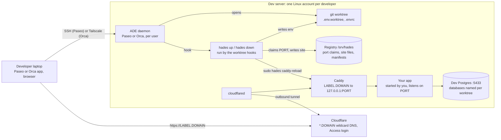

# Hades

A shared Linux dev server for agentic development, and the CLI that runs on it.

Each developer has their own account, their own agentic development environment (ADE:
[Paseo](https://getpaseo.com) or [Orca](https://github.com/stablyai/orca)) running as a daemon, and
their own git worktrees. Every web worktree gets its own port, database names, environment file and
a URL behind a login. The CLI, `hades`, is what the ADE's worktree hooks call; it also works alone on
a laptop.

A worktree's *label* is `<project>-<name>` (Orca: the workspace name); its URL is
`https://<label>.<domain>`.



| Piece | What it does |
|---|---|
| `hades` CLI | `up` claims a port, names the worktree's databases, writes `.env.worktree` and `.envrc`, publishes a Caddy site and runs the project's setup. `down` reverses it. |
| Ansible collection `quotedo.hades` | Builds and runs the server: accounts, ADE daemons, a shared tool store, dev Postgres, RabbitMQ, LocalStack, Caddy, Cloudflare tunnel and Access, loopback isolation, backups, optional intranet VPN. |

## Quick start: developer

1. Send the operator your GitHub login and the email you will log in with.
2. Log `gh` in on your laptop and [install the CLI](docs/cli.md#install).
3. Run `hades join <host>`. It sets up SSH, then runs the first-login steps on the box.
4. Add the box in Paseo Desktop with the address and password printed at the end.

Full journey: [Developer guide](docs/developer.md).

## Quick start: operator

1. Copy `ansible/inventory.example.yml` to `ansible/inventory.yml` and fill it in.
2. Copy `ansible/.env.example` to `ansible/.env`, fill in the secrets and export them.
3. Apply and verify from `ansible/`:

   ```sh
   ansible-playbook playbooks/site.yml
   ansible-playbook playbooks/verify.yml
   ```

4. Send each developer the host name.

Full reference: [Server reference](docs/server.md).

## Documentation

- [Developer guide](docs/developer.md): joining a server, worktrees, troubleshooting.
- [Server reference](docs/server.md): requirements, inventory, secrets, onboarding, offboarding, operations.
- [CLI reference](docs/cli.md): install, laptop use, commands, exit codes, files, `hades.toml`, host config, hooks.
