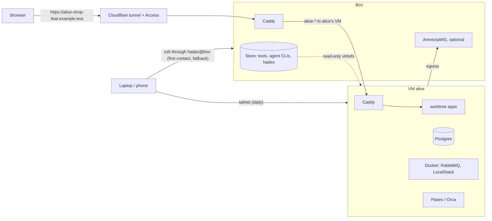

# Hades

Host for ADEs: one dev box for a team, a virtual machine per developer for agentic development
environments, and the CLI that runs in each VM.

Each developer has their own Incus VM on the box: their machine, with sudo, Docker and Postgres, an
agentic development environment (ADE: [Paseo](https://getpaseo.com) or
[Orca](https://github.com/stablyai/orca)) always on, and their git worktrees. Every web worktree
gets its own port, database names, environment file and a URL behind a login. The CLI, `hades`, is
what the ADE's worktree hooks call; it also works alone on a laptop. The Ansible collection
`quotedo.hades` builds and runs the box.

## What you get

- One VM per developer, sized per box or per developer; an apply never restarts a running VM.
- One read-only tool store shared by every VM (Erlang, Elixir, Node, Python, Go, kubectl, gh, the agent CLIs), pinned to exact versions in the inventory: adding a version is one edit and one apply.
- Per worktree: a port, database names, a RabbitMQ vhost, `.env.worktree` and `.envrc` (direnv), written by `hades up` and removed by `hades down`.
- A URL per worktree, `https://<developer>-<project>-<name>.<domain>`, through a Cloudflare tunnel and behind Cloudflare Access: email one-time PIN, 30-day sessions, an allow-list in the inventory.
- MCP entries written into the worktree's agent configs: Tidewave for Phoenix projects, chrome-devtools with a Chrome for Testing in the VM.
- Daily access over the developer's own tailnet, from laptop and phone; SSH through the box for first contact and as the fallback.
- Onboarding in one laptop command, `hades join <host>`; offboarding by `state: absent`, which archives the home and deletes the VM.
- Optional: an intranet VPN (AmneziaWG) on the box for every VM.



## Quick start: developer

1. Send the administrator your GitHub login and the email you will log in with.
2. Install Tailscale on your laptop and log in to your own tailnet.
3. Log `gh` in on your laptop and [install the CLI](docs/cli.md#install).
4. Run `hades join <host>`. It sets up SSH, then runs the first-login steps in your VM, the Tailscale login included.
5. Add your VM in Paseo Desktop with the address and password printed at the end.

Full journey: [Developer guide](docs/developer.md).

## Quick start: administrator

1. Copy `ansible/inventory.example.yml` to `ansible/inventory.yml` and fill it in: an Ubuntu box with KVM and its developers.
2. Copy `ansible/.env.example` to `ansible/.env`, fill in the secrets and export them.
3. Apply and verify from `ansible/`:

   ```sh
   ansible-playbook playbooks/site.yml
   ansible-playbook playbooks/verify.yml
   ```

4. Give each developer read access to the hades repository and send them the host name.

Full reference: [Server reference](docs/server.md).
