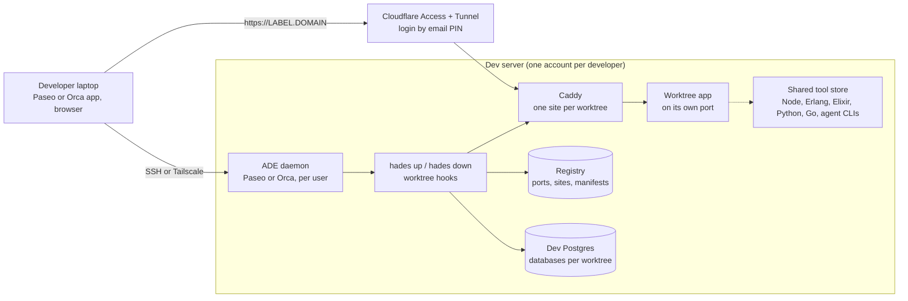

# Hades

A dev server for agentic development, and the CLI that runs on it.

Several developers share one Linux box. Each has their own account, their own agentic development
environment (ADE: [Paseo](https://getpaseo.com) or [Orca](https://github.com/stablyai/orca)) running as
a daemon, and their own git worktrees. Every worktree an agent opens gets, automatically, its own
port, databases, environment file and a public URL behind a login. The CLI, `hades`, is what the
ADE's worktree hooks call to make that happen; it also works alone on a laptop.

## How it works



| Piece | What it does |
|---|---|
| `hades` CLI | Gives a git worktree a port, a label, databases, `.env.worktree`/`.envrc`, a Caddy site, MCP wiring; takes them away on `down`. Called by ADE hooks or by hand. |
| Ansible collection `quotedo.hades` | Turns an Ubuntu box into the server: accounts, ADE daemons, the tool store, dev Postgres, RabbitMQ and LocalStack, Caddy, Cloudflare tunnel and Access, loopback isolation, backups, optional intranet VPN. |

## Quick start

### Developer on an existing server

1. Get an account from the server's administrator (your SSH public key, your email for the login page).
2. Add the box to your laptop's `~/.ssh/config` with `ForwardAgent yes`, and accept the Tailscale share if the box uses one.
3. Connect your ADE: Paseo Desktop "Remote SSH" with the password the administrator gives you, or read Orca's pairing URL from `journalctl --user -u orca.service` on the box.
4. Clone your project on the box and open a worktree from the ADE. The hook runs `hades up`; the app is at `https://<project>-<branch>.<domain>` after you log in with your email.
5. `hades ls`, `hades status`, `hades env` show what you have; closing the worktree runs `hades down`.

Details: [Developer guide](docs/developer.md).

### Operator setting up a server

1. Install Ansible (`ansible-core` 2.16+) and the collection's requirements; copy `ansible/inventory.example.yml` to a private inventory and fill in the domain, tools, users and the pre-existing workloads to protect.
2. Export the secrets from a private `.env` (Cloudflare account id and API token; the VPN config if used).
3. `ansible-playbook -i inventory.yml playbooks/preflight.yml`, then `site.yml` one tag group at a time, then `verify.yml`.
4. Set the administrator's sudo password, run `tailscale up` if Orca or Tailscale sharing is wanted, hand each developer their Paseo password.

Details: [Server reference](docs/server.md).

### CLI alone on a laptop

```sh
go install github.com/quotedo/hades/cmd/...@latest   # or download a release
cd your-repo && hades init && git add -A && git commit -m "add hades"
```

Open a worktree from your ADE; `hades up` runs on your laptop's Postgres with a local port and no URL.
Details: [CLI reference](docs/cli.md).

## Documentation

- [Developer guide](docs/developer.md): using a hades server day to day.
- [Server reference](docs/server.md): inventory, secrets, apply, verify, onboarding, offboarding, upgrades.
- [CLI reference](docs/cli.md): commands, `hades.toml`, host config, ADE hooks, environment variables.
- Design records, for contributors: [CLI](docs/superpowers/specs/2026-10-23-hades-cli-design.md), [server](docs/superpowers/specs/2026-10-23-hades-server-design.md) and its [second revision](docs/superpowers/specs/2026-10-24-hades-server-v2-design.md).

## Guarantees

- `hades` never drops a database, releases a port, removes a site or deletes a vhost that the manifest it acts on does not list, and never acts on another user's manifest (except `gc` as root, on vanished worktrees).
- It modifies no tracked file other than the MCP configs, and never commits, pushes or changes branches.
- `up` rolls back what it claimed in the failing run, nothing older. `down` is best effort and exits 0 unless `--strict`.
- Credentials reach project commands only as documented environment variables, written nowhere but the two env files in the worktree.
- On the server: nobody but the one administrator has sudo; developers cannot install software; every secret the playbooks handle travels over stdin, never through a file on the controller or a command line.
