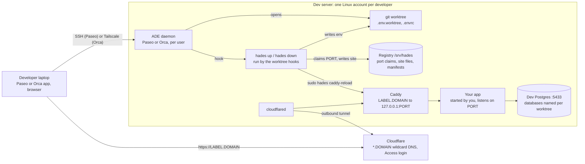

# Hades

A dev server for agentic development, and the CLI that runs on it.

Several developers share one Linux box. Each has their own account, their own agentic development
environment (ADE: [Paseo](https://getpaseo.com) or [Orca](https://github.com/stablyai/orca)) running as
a daemon, and their own git worktrees. Every web worktree an agent opens gets its own port, its own
database names, an environment file and a public URL behind a login. The CLI, `hades`, is what the
ADE's worktree hooks call to make that happen; it also works alone on a laptop.

A worktree's *label* is `<project>-<branch>` (for Orca, the workspace name); its URL is
`https://<label>.<domain>`.

## How it works



| Piece | What it does |
|---|---|
| `hades` CLI | On `up`: claims a port, computes the worktree's database names and variables, writes `.env.worktree` and `.envrc`, publishes a Caddy site, points the repo's MCP configs at this worktree, runs the project's setup (which creates the databases). On `down`: the reverse. Called by ADE hooks or by hand. |
| Ansible collection `quotedo.hades` | Turns an Ubuntu box into the server: accounts, ADE daemons, a shared tool store, dev Postgres, RabbitMQ and LocalStack, Caddy, Cloudflare tunnel and Access, loopback isolation, backups, optional intranet VPN. |

## Quick start

### Developer on an existing server

1. Give the administrator your SSH public key and the email you will log in with.
2. On your laptop, add the box to `~/.ssh/config` with `ForwardAgent yes`; accept the Tailscale share if the box uses one.
3. Connect your ADE: Paseo Desktop "Remote SSH" with the password the administrator gives you, or read Orca's pairing URL on the box with `journalctl --user -u orca.service`.
4. On the box: `gh auth login`, `gh auth setup-git`, and each agent CLI's own login.
5. Clone your project. Its repository must contain the hooks (`paseo.json` or `orca.yaml`, written by `hades init`); open a worktree from the ADE and the hook runs `hades up`.
6. Start the app on `$PORT` (direnv loads `.env.worktree`; a declared Paseo service gets the port from `hades-port`). It is then at `https://<label>.<domain>` after you log in with your email.

Details: [Developer guide](docs/developer.md).

### Operator setting up a server

1. Install `ansible-core` 2.17+ and the collection's requirements; copy `ansible/inventory.example.yml` to a private inventory: domain, tool versions, users, and the `protected` block (services already on the box that dev accounts must not starve or reach).
2. Export the secrets from a private `.env`: Cloudflare account id and API token, the VPN config if used.
3. `ansible-playbook -i inventory.yml playbooks/preflight.yml`, then `site.yml` one tag group at a time, then `verify.yml` per tag.
4. Set the administrator's sudo password, run `tailscale up` if Orca or Tailscale sharing is wanted, hand each developer their Paseo password.

Details: [Server reference](docs/server.md).

### CLI alone on a laptop

Needs Postgres on `127.0.0.1:5432` (`postgres`/`postgres`, or `HADES_DB_*` overrides) and the project config snippet that `hades init` prints.

```sh
GOPRIVATE=github.com/quotedo/* go install github.com/quotedo/hades/cmd/...@latest
cd your-repo && hades init
git add hades.toml paseo.json orca.yaml .gitignore && git commit -m "add hades"
```

Open a worktree from your ADE: `hades up` claims a port and the app, once started, is at `http://localhost:<port>`.
Details: [CLI reference](docs/cli.md).

## Documentation

- [Developer guide](docs/developer.md): using a hades server day to day.
- [Server reference](docs/server.md): inventory, secrets, apply, verify, onboarding, offboarding, operations.
- [CLI reference](docs/cli.md): commands, `hades.toml`, host config, ADE hooks, environment variables, safety rules.
