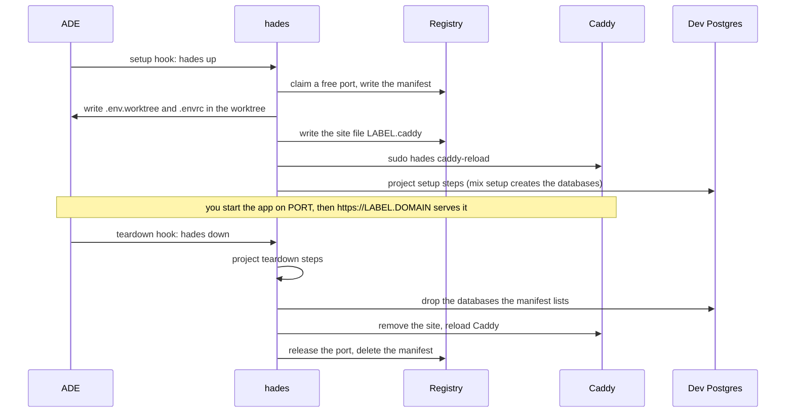

# Developer guide

For a developer with an account on a hades server. Commands, flags, files and variables are in the [CLI reference](cli.md); the administrator's side is in the [server reference](server.md).

## What you get

| | |
|---|---|
| Account | Your own Linux user and home; no sudo unless you are the box's administrator. |
| ADE | Paseo or Orca running as a daemon under your account, always on. |
| Tools | One shared store; `mise ls` shows what is installed. Exact versions, the same for everyone, chosen by the administrator. |
| Per web worktree | A port, a label, database names, `.env.worktree` and `.envrc`, a Caddy site and `https://<label>.<domain>`. Non-web projects (Go, Node, or `web = false`) get the env files only. |
| Shared services | Dev Postgres, RabbitMQ, LocalStack on loopback, reachable only by dev accounts. |
| Backups | Your ADE state and agent logins, nightly at 03:30, newest seven kept, root-only. |

## Connect

1. Send the administrator your SSH public key and the email you will log in with.
2. On your laptop:

   ```
   # ~/.ssh/config
   Host <box>
     HostName <box address or Tailscale name>
     User <your login>
     ForwardAgent yes
   ```

   `ForwardAgent yes` lets you reach production hosts from the box with the keys that stay on your laptop.
3. If the box is shared over Tailscale, accept the share; the box appears in your own tailnet.
4. **Paseo:** in Paseo Desktop choose "Remote SSH", host as above, and the password the administrator read off the first apply. It lives in `~/.config/hades/paseo.env` on the box.
   **Orca:** `journalctl --user -u orca.service` on the box prints the pairing URL.
5. On the box: `gh auth login`, `gh auth setup-git`, and each agent CLI's own login. Then clone your projects.

## A worktree's life



The hooks live in the repository (`paseo.json`, `orca.yaml`, written by `hades init`), so every worktree the ADE opens goes through `hades up` and every one it closes through `hades down`. You can run both yourself inside a worktree.

| Fact | Value |
|---|---|
| Label | `<project>-<branch>` (Orca: the workspace name), cut to 63 characters, fixed at the first `up`. `hades up` prints `<label> up at <url>`; later `hades ls --mine`. |
| URL | `https://<label>.<domain>`. Open it, enter your email, type the PIN Cloudflare mails you; the session lasts 30 days. |
| App | Nothing starts it for you. Run it on `$PORT` (direnv loads `.env.worktree`), or declare it as a Paseo service, which gets the port from `hades-port`. |
| Databases | `<app>_dev<suffix>` and `<app>_test<suffix>` with suffix `_<user>_<branch>`; the project's setup creates them, `hades down` drops only those. |
| Variables | `PORT`, `PHX_HOST`, `HADES_URL`, `DB_*`, `DATABASE_URL`, `SECRET_KEY_BASE` and the project's own; `hades env` prints them, the [CLI reference](cli.md#what-up-writes) lists them. |

## Commands you will use

| Command | Purpose |
|---|---|
| `hades ls --mine` | Your worktrees with port and URL; without `--mine`, everyone's. `--json` for scripts. |
| `hades status` | The box: mode, free ports, worktrees, Postgres and Caddy reachability. |
| `hades env` | The worktree's variables as export lines; `--json`. |
| `hades port` | The worktree's port. |
| `hades doctor` | What is misconfigured, with the fix. Run it first when something is off. |
| `hades up` / `hades down` | What the hooks run. `up --skip-setup` skips the project's setup steps; `down --strict` exits 1 when any step failed. |

## Tools and versions

- A project's `.tool-versions` or `mise.toml` picks among the installed versions. A version the store lacks fails with `Tool not installed for shim: <tool>`: ask the administrator; you cannot install it yourself.
- `~/.tool-versions` in your home overrides the box default for you alone.
- Hex, rebar and Mix archives live in your own `~/.mix`.
- Agent CLIs do not self-update; the administrator moves everyone together.

## Shared services

| Service | Address from the box | Credentials |
|---|---|---|
| Postgres (dev cluster) | `127.0.0.1:5433` | `postgres` / `postgres`, exported as `DB_*` |
| RabbitMQ | AMQP `127.0.0.1:5672`, MQTT `127.0.0.1:1883`, management `http://127.0.0.1:15672` | `guest` / `guest`; a vhost per worktree when `hades.toml` asks for one |
| LocalStack | `http://127.0.0.1:14566` | none; S3 only, state lost on restart |
| Redis (if the box lists it) | `127.0.0.1:6379` | none |

## Who can see what

- Every dev account shares the Postgres superuser, so anyone can read or drop anyone's databases.
- Every dev account can connect to every worktree port and every Paseo or Orca port on the box. Paseo asks for its password.
- Every email on the Access allow-list can open every worktree URL.
- Only dev accounts, Caddy and the services themselves reach the dev ports; other accounts on the box are refused. A port listed as blocked by the administrator (a production database, for example) is refused to dev accounts.

## Intranet and production

- **Intranet:** when the administrator enabled the VPN, intranet hosts are reachable from the box by everyone. Nothing to configure.
- **Kubernetes:** ask the operator for a kubeconfig with your own client certificate; put it in `~/.kube/config` on the box and `chmod 600` it. `kubectl` comes from the tool store.
- **SSH to production:** keys stay on your laptop; the forwarded agent (1Password or any other) is used while your session is open.
- **Exposure:** every agent your ADE runs can use that kubeconfig at any time with your full rights and no prompt. If you want a prompt for production, keep the production kubeconfig on your laptop.

## Troubleshooting

| Symptom | Check |
|---|---|
| The URL answers 502 | Nothing listens on the worktree's port: start the app (`hades port` prints the port). |
| The URL shows a Cloudflare login | Expected once per 30 days; use the email the administrator registered. |
| The URL redirects to the apex domain | No worktree is live under that label; `hades ls` shows the labels. |
| `label ... taken by ...` | Another developer has the same project and branch: rename your branch, or ask the administrator for a label template with the user in it. |
| `hades up` fails on a setup step | The manifest and env files are kept; fix the project and run `hades up` again. |
| `Tool not installed for shim` | The project pins a version the store lacks; ask the administrator. |
| `mix` cannot write to `/usr/local/share/mise/...` | Your shell lacks `MIX_HOME`; open a login shell or `export MIX_HOME=~/.mix MIX_ARCHIVES=~/.mix/archives`. |
| Deleted a worktree without `down` | Its port and databases are released by the weekly `hades gc`, or sooner by the administrator with `sudo hades gc`. |
| Paseo or Orca is down | `systemctl --user status paseo.service` (or `orca.service`); `systemctl --user restart` it. Orca terminals do not survive a restart. |
| Anything else | `hades doctor`. |

## Leaving

The administrator sets your account to `absent`: your worktrees are released, your home is archived (root-only, kept) and the account is deleted. Revoke your own credentials too: production certificate and keys, GitHub access, the Tailscale share.
