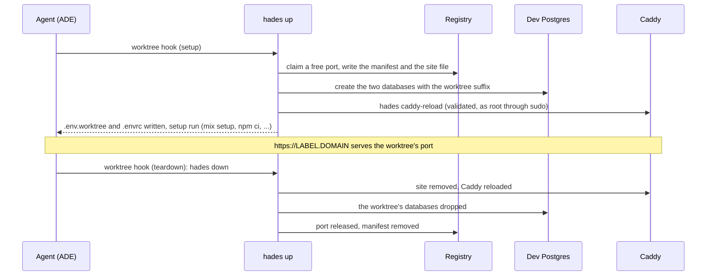

# Developer guide

For a developer with an account on a hades server. The administrator's side is in the [server reference](server.md); the CLI's flags and files are in the [CLI reference](cli.md).

## What you get

| | |
|---|---|
| Account | Your own Linux user and home; no sudo (only the box's administrator has it). |
| ADE | Paseo or Orca running as a daemon under your account, always on. |
| Tools | One shared store: Node, Erlang, Elixir, Python, Go, kubectl, gh, `claude`, `codex`, `paseo`. Exact versions, the same for everyone. |
| Per worktree | A port, a label, databases, `.env.worktree` and `.envrc`, a Caddy site and `https://<label>.<domain>`. |
| Shared services | Dev Postgres, RabbitMQ, LocalStack on loopback, reachable only by dev accounts. |
| Backups | Your ADE state and agent logins, nightly, kept seven days, root-only. |

## Connect

1. Send the administrator your SSH public key and the email you will log in with.
2. On your laptop:

   ```
   # ~/.ssh/config
   Host <box>
     HostName <box address or Tailscale name>
     User <your login>
     ForwardAgent yes
   ```

   `ForwardAgent yes` lets you reach production hosts from the box with the keys that stay on your laptop.
3. If the box is shared over Tailscale, accept the share; the box appears in your own tailnet.
4. **Paseo:** in Paseo Desktop choose "Remote SSH", host as above, and the password the administrator read off the first apply. It lives in `~/.config/hades/paseo.env` on the box. For a phone: `paseo daemon pair --relay` on the box.
   **Orca:** `journalctl --user -u orca.service` on the box prints the pairing URL.
5. Once on the box: `gh auth login`, `gh auth setup-git`, and each agent CLI's own login.

## A worktree's life



The hooks are in the repository (`paseo.json`, `orca.yaml`, written by `hades init`), so every worktree the ADE opens goes through `hades up`, and every one it closes through `hades down`. You can also run both yourself inside a worktree.

| Fact | Value |
|---|---|
| Label | `<project>-<branch>` by default, cut to 63 characters; fixed at the first `up`. |
| URL | `https://<label>.<domain>`, served through Cloudflare. Open it, enter your email, type the PIN Cloudflare mails you; the session lasts 30 days. |
| Port | From the box's range (4100–4999 by default); `hades port` prints it. |
| Databases | `<app>_dev<suffix>` and `<app>_test<suffix>`, suffix `_<user>_<branch>`. Only those are dropped on `down`. |
| Environment | `PORT`, `PHX_HOST`, `HADES_URL`, `DB_HOST`, `DB_PORT`, `DB_USER`, `DB_PASSWORD`, `DB_SUFFIX`, `DATABASE_URL`, `TEST_DATABASE_URL`, `SECRET_KEY_BASE`, `HADES_LABEL`, plus the project's `[env]`. `hades env` prints them. |

## Commands you will use

| Command | Purpose |
|---|---|
| `hades ls` | Your worktrees and their ports and URLs (`--json` for scripts). |
| `hades status` | The box: mode, free ports, worktrees, Postgres and Caddy reachability. |
| `hades env` | The worktree's variables (`--shell` to `eval`, `--json`). |
| `hades doctor` | What is misconfigured, with the fix. Run it first when something is off. |
| `hades up` / `hades down` | What the hooks run; `up --skip-setup` skips the project's setup steps, `down --strict` fails on the first problem instead of continuing. |
| `hades init` | In a new repository: writes `hades.toml` and the ADE hook files. |

## Tools and versions

The box has one tool store, managed by the administrator. `node`, `erl`, `mix`, `python3`, `go`, `kubectl`, `gh`, `claude`, `codex` and `paseo` are on your PATH in every shell and in your ADE.

- A project's `.tool-versions` or `mise.toml` picks among the installed versions. A version the store lacks fails with `Tool not installed for shim: <tool>`: ask the administrator to add it; you cannot install it yourself.
- `mise ls` shows what is installed. `~/.tool-versions` in your home overrides the box default for you alone.
- Hex, rebar and your Mix archives live in your own `~/.mix`.
- Agent CLIs do not self-update; the administrator moves everyone together.

## Shared services

| Service | Address from the box | Credentials |
|---|---|---|
| Postgres (dev cluster) | `127.0.0.1:5433` | `postgres` / `postgres`, exported as `DB_*` |
| RabbitMQ | `amqp://127.0.0.1:5672`, management `http://127.0.0.1:15672` | `guest` / `guest`; a vhost per worktree when `hades.toml` asks for one |
| LocalStack | `http://127.0.0.1:14566` | none |

Only dev accounts, Caddy and the services themselves can connect to these ports. A production Postgres on the same box, if any, is blocked for dev accounts.

## Intranet and production

- **Intranet:** when the administrator enabled the VPN, intranet hosts are reachable from the box by everyone. Nothing to configure.
- **Kubernetes:** ask the operator for a kubeconfig with your own client certificate; put it in `~/.kube/config` on the box and `chmod 600` it. `kubectl` comes from the tool store.
- **SSH to production:** keys stay on your laptop; the forwarded agent (1Password or any other) is used while your session is open.
- **Exposure:** every agent your ADE runs can use that kubeconfig at any time with your full rights and no prompt. If you want a prompt for production, keep the production kubeconfig on your laptop.

## Troubleshooting

| Symptom | Check |
|---|---|
| `hades up` fails on a setup step | The manifest and env files are kept; fix the project and run `hades up` again. |
| `Tool not installed for shim` | The project pins a version the store lacks; ask the administrator. |
| The URL shows a Cloudflare login | Expected once per 30 days; use the email the administrator registered. |
| The URL redirects to the apex domain | No worktree is live under that label; `hades ls` shows the labels. |
| `mix` cannot write to `/usr/local/share/mise/...` | Your shell lacks `MIX_HOME`; open a login shell or `export MIX_HOME=~/.mix MIX_ARCHIVES=~/.mix/archives`. |
| Paseo or Orca is down | `systemctl --user status paseo.service` (or `orca.service`); `systemctl --user restart` it. Orca terminals do not survive a restart. |
| Anything else | `hades doctor`. |

## Leaving

The administrator sets your account to `absent`: your worktrees are released, your home is archived (root-only, kept) and the account is deleted. Revoke your own credentials too: production certificate and keys, GitHub access, the Tailscale share.
