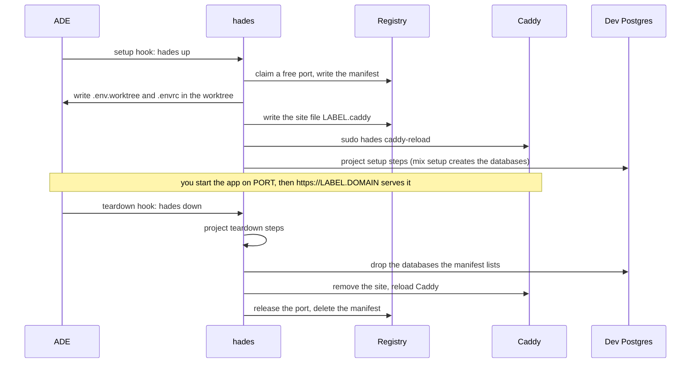

# Developer guide

For a developer with an account on a hades server. Command flags, exit codes and files are in the
[CLI reference](cli.md); the administrator's side is in the [server reference](server.md).

## What you get

| | |
|---|---|
| Account | Your own Linux user and home; no sudo unless your entry has `admin: true`. |
| ADE | Paseo or Orca running as a daemon under your account, always on. |
| Tools | One shared store with exact versions chosen by the administrator; `mise ls` lists them. |
| Per worktree | A label, database names, `.env.worktree` and `.envrc`; web projects also get a port and `https://<label>.<domain>`. |
| Shared services | Dev Postgres, RabbitMQ and LocalStack on loopback. |
| Backups | Your ADE state and agent logins, nightly between 03:30 and 04:00, newest seven kept, root-only. |

## Before you start

| Need | Why |
|---|---|
| Read access to the hades GitHub repository | Its releases are private; the CLI download goes through your GitHub login. |
| `gh` on your laptop, logged in (`gh auth login`) | Downloads the CLI; `hades join` reads your GitHub login from it and uploads a key when GitHub has none of yours. |
| Paseo Desktop on your laptop (Orca users: the Orca app and Tailscale) | Connects to your ADE on the box. |
| An entry in the server's inventory | Send the administrator your GitHub login and the email you will log in with; they apply and send you the host name. |
| `hades init` run once per project, its files committed | Without `paseo.json` or `orca.yaml` in the repository, no worktree runs `hades up`. See the [CLI reference](cli.md#commands). |

## Join

1. [Install the CLI](cli.md#install) on your laptop.
2. Run:

   ```sh
   hades join <host>
   ```

   Add `--as <login>` when your login on the box differs from your laptop's `$USER`. Add
   `--alias <alias>` for an IP address. Add `--github <GitHub login>` when `gh` is not logged in.
3. Orca users: accept the Tailscale share; the box appears in your own tailnet.
4. Connect your ADE with what `hades join` prints at the end (see [Connect your ADE](#connect-your-ade)).

Rerunning `hades join` is always safe. What it does, in order:

| Step | Action |
|---|---|
| Key | Takes the first key in `~/.ssh/*.pub` or your SSH agent that GitHub already serves at `https://github.com/<GitHub login>.keys`. Without one, it takes `~/.ssh/id_ed25519.pub` or the first `~/.ssh/*.pub`, or generates `~/.ssh/id_ed25519` without a passphrase. |
| GitHub | Uploads that key with `gh ssh-key add`, titled `hades <alias>`, only when GitHub serves none of your keys and `gh` is logged in as that GitHub login. |
| SSH config | Writes a block between `# hades:begin <alias>` and `# hades:end <alias>` in `~/.ssh/config`: `Host`, `HostName`, `User`, `ForwardAgent yes`, `StrictHostKeyChecking accept-new`, and `IdentityFile` for a key on disk. It touches nothing else. |
| Test | Logs in once without a prompt. A new host key is accepted; a changed one is refused. |
| Hand-off | Runs `ssh -t <alias> hades-onboard <alias>` on your terminal: the first-login steps below. |

The alias is the host's first DNS label (`shop` for `shop.example.test`) unless you pass `--alias`.

`ForwardAgent yes` lets you reach production hosts from the box with keys that stay on your laptop.
ssh takes the first value it finds for each option, so an earlier `Host *` entry that sets `User`,
`IdentityFile` or `ForwardAgent` wins over the block: move that entry below it.

## First-login steps

`hades-onboard` runs from `hades join`. To run it by hand, use `ssh -t <alias> hades-onboard <alias>`;
it refuses to run without a terminal, and the second `<alias>` goes into the printed Paseo address.
Each step prints `already done` or does its work.

| Step | Does |
|---|---|
| GitHub | `gh auth login -h github.com -p https -w`: a code to enter in your browser. |
| git | `gh auth setup-git`, so git reaches GitHub with your `gh` login. |
| Claude Code, Codex | `claude auth login` and `codex login --device-auth`, for each one not logged in. |
| Repositories | Clones each repository the administrator listed into `~/<name>`, unless that directory exists. A failed clone ends the run with `onboarding incomplete: clone <names> failed; run hades-onboard again`. |
| Check | `hades doctor`. A FAIL ends the run with `onboarding incomplete: fix the FAIL lines above and run hades-onboard again`. |
| Done | Writes `~/.config/hades/onboarded`, prints `onboarding complete`, then the ADE connection details. |

Until onboarding completes, every interactive shell prints
`Run hades-onboard to finish setting up your account.` Run `hades-onboard` again at any time to
print the connection details again.

## Connect your ADE

**Paseo.** `hades-onboard` ends with:

```
Paseo Desktop: Settings > Add host > Remote SSH
  ssh://<login>@<alias>?daemonPort=<port>
  Daemon password: <password>
```

In Paseo Desktop open Settings, Add host, Remote SSH, and enter the address and the Paseo password.
The address has no `?daemonPort=` part when your Paseo port is Paseo's default, 6767.

**Orca.** `hades-onboard` ends with `Orca pairing: <url>`; open that URL in the Orca app. While
Orca has not logged the URL yet, it prints `Orca pairing URL: journalctl --user -u orca.service`:
run that command on the box later.

## Your SSH keys

- The box writes `~/.ssh/authorized_keys` from `https://github.com/<GitHub login>.keys`, plus any key the administrator listed for you.
- It refreshes every hour and at every apply.
- A key you add on GitHub works within the hour, and so does a removal, except of your last GitHub key: an empty fetch keeps the file.
- A new laptop: run `hades join` there.

## A worktree's life



| Fact | Value |
|---|---|
| Label | Defined in the [CLI reference](cli.md#commands). `hades up` prints `hades: <label> up at <url>` on stderr. |
| URL | `https://<label>.<domain>`. Enter your email and the PIN Cloudflare mails you; the session lasts 30 days. |
| App | Nothing starts it for you. Run it on `$PORT` (direnv loads `.env.worktree`), or declare it as a Paseo service, which gets the port from `hades-port`. |
| Databases | `<app>_dev<suffix>` and `<app>_test<suffix>`, suffix `_<user>_<name>`. The project's setup creates them; `hades down` drops only those. |
| Variables | `hades env` prints them; the [CLI reference](cli.md#what-up-writes) lists them. |

Day to day: `hades ls` lists your worktrees, `hades env` and `hades port` describe the current
one, and `hades doctor` says what is wrong and how to fix it. The [CLI reference](cli.md#commands)
has every command.

## Tools and versions

- A project's `.tool-versions` or `mise.toml` picks among the installed versions.
- A version the store lacks fails with `Tool not installed for shim: <tool>`. Ask the administrator; you cannot install it yourself.
- `~/.tool-versions` in your home overrides the box default for you alone.
- Hex, rebar and Mix archives live in your own `~/.mix`.
- Agent CLIs do not self-update; the administrator moves everyone together.

## Shared services

| Service | Address from the box | Credentials |
|---|---|---|
| Postgres (dev cluster) | `127.0.0.1:5433` | `postgres` / `postgres`, exported as `DB_*` |
| RabbitMQ | AMQP `127.0.0.1:5672`, MQTT `127.0.0.1:1883`, management `http://127.0.0.1:15672` | `guest` / `guest`; a vhost per worktree when `hades.toml` asks for one |
| LocalStack | `http://127.0.0.1:14566` | none; S3 only, state lost on restart |
| Redis, when the box lists it | `127.0.0.1:6379` | none |

## Who can see what

- Every dev account shares the Postgres superuser, so anyone can read or drop anyone's databases.
- Every dev account can connect to every worktree port and every ADE port on the box. Paseo asks for its password.
- Every email on the Access allow-list can open every worktree URL.
- Other accounts on the box are refused on the dev ports. A port the administrator blocks, such as a production database, is refused to dev accounts.

## Intranet and production

- **Intranet:** when the administrator enabled the VPN, intranet hosts are reachable from the box by everyone.
- **Kubernetes:** put a kubeconfig with your own client certificate in `~/.kube/config` on the box and `chmod 600` it. `kubectl` is in the tool store when the administrator lists it in `tools`.
- **SSH to production:** keys stay on your laptop; the forwarded agent is used while your session is open.
- **Exposure:** every agent your ADE runs can use that kubeconfig at any time with your full rights. Keep a production kubeconfig on your laptop if you want a prompt.

## Troubleshooting

`hades join` says `not authorised yet` when the box refuses your key. Its second line says whether
your key is on GitHub. The causes:

| Cause | Fix |
|---|---|
| Your key is not on GitHub | Follow the `github:` line printed earlier. `gh is not logged in`: `gh auth login`, then rerun. `gh lacks the admin:public_key scope`: `gh auth refresh -h github.com -s admin:public_key`, then rerun. `gh is logged in as <account>, not <GitHub login>`, or any other error: add the printed key at https://github.com/settings/keys. Without GitHub: send the printed key to the administrator. |
| Your key is on GitHub, the box has not refreshed yet | Wait for the hourly refresh, or ask the administrator to run `sudo hades-keys <login>`. Then rerun. |
| Your entry names another GitHub login | The message names the GitHub login your key is on; the administrator sets that as `github:` in your entry and applies. |
| Your login on the box differs from your laptop's `$USER` | Rerun with `--as <login>`. |
| sshd on the box admits only listed users | The administrator applies again: the server adds every developer to `AllowUsers`. A box that uses `AllowGroups` needs group `hades` added by the administrator. |

Other symptoms:

| Symptom | Fix |
|---|---|
| `join: ssh: Host key verification failed.` | The box's host key changed. Confirm with the administrator, then `ssh-keygen -R <host>` and rerun. |
| `join: ssh: ...` naming a host, timeout or refusal | The host name or network is wrong; check `hades join`'s arguments. |
| `hades-onboard needs a terminal` | Run `ssh -t <alias> hades-onboard <alias>`. |
| `onboarding incomplete: clone <name> failed` | You lack access to that repository on GitHub; ask for it, then run `hades-onboard` again. |
| `WARN ade-hooks: no paseo.json or orca.yaml` | Run `hades init` in the repository and commit its files. |
| Paseo Desktop cannot connect | Check the address and Paseo password from `hades-onboard`; on the box, `systemctl --user status paseo.service`. The password is also in `~/.config/hades/paseo.env`. |
| `hades: port: no hades manifest for <path>; run hades up` | The worktree has no manifest: run `hades up` in it. |
| `hades: port: <label> has no web port` | The project is not a web project: set `web = true` in `hades.toml`, then `hades up`. |
| The URL answers 502 | Nothing listens on the worktree port: start the app (`hades port` prints the port). |
| The URL redirects to the apex domain | No worktree is live under that label; `hades ls` shows the labels. |
| `label ... taken by ...` | Another developer has the same project and name, or you have the same branch in two worktrees: rename the branch, or ask for a label template with the user in it. |
| `hades up` fails on a setup step | The manifest and env files are kept; fix the project and run `hades up` again. |
| `mix` cannot write to `/usr/local/share/mise/...` | Your shell lacks `MIX_HOME`: open a new shell, or `export MIX_HOME=~/.mix MIX_ARCHIVES=~/.mix/archives`. |
| Deleted a worktree without `down` | The weekly `hades gc` releases its port and databases; the administrator can run `sudo hades gc` sooner. |
| Paseo or Orca is down | `systemctl --user restart paseo.service` (or `orca.service`). Orca terminals do not survive a restart. |
| Anything else | `hades doctor`: every FAIL line ends with its fix. |

## Leaving

The administrator sets your entry to `absent`: your worktrees are released, your home is archived
(root-only) and the account is deleted. Revoke your own credentials too: production certificate and
keys, GitHub access, the Tailscale share.
