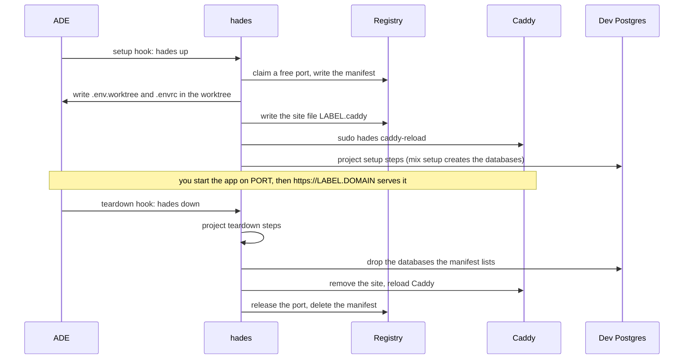

# Developer guide

For a developer with an account on a hades server. Commands, flags, files and variables are in the [CLI reference](cli.md); the administrator's side is in the [server reference](server.md).

## What you get

| | |
|---|---|
| Account | Your own Linux user and home; no sudo unless you are the box's administrator. |
| ADE | Paseo or Orca running as a daemon under your account, always on. |
| Tools | One shared store; `mise ls` shows what is installed. Exact versions, the same for everyone, chosen by the administrator. |
| Per web worktree | A port, a label, database names, `.env.worktree` and `.envrc`, a Caddy site and `https://<label>.<domain>`. Non-web projects (Go, Node, or `web = false`) get the env files only. |
| Shared services | Dev Postgres, RabbitMQ, LocalStack on loopback, reachable only by dev accounts. |
| Backups | Your ADE state and agent logins, nightly at 03:30, newest seven kept, root-only. |

## Connect

1. Give the administrator your GitHub login and the email you will log in with. They add you to the inventory, apply, and tell you the box's host name.
2. Install the CLI on your laptop ([CLI reference](cli.md#install)) and log `gh` in with `gh auth login`.
3. On your laptop:

   ```sh
   hades join <box> --as <your login>
   ```

   `--as` defaults to your laptop's `$USER`. For an IP address, add `--alias <name>`: the name you will use with `ssh`.
4. If the box is shared over Tailscale (Orca), accept the share; the box appears in your own tailnet.

What `hades join` does, in order:

| Step | Action |
|---|---|
| Key | Uses `~/.ssh/id_ed25519.pub`, else the first `~/.ssh/*.pub`; with none, generates `~/.ssh/id_ed25519` without a passphrase. |
| GitHub | Adds the key to your GitHub account through `gh`, titled `hades <alias>`, unless it is there already. When `gh` is missing or logged out it says so and goes on: send the key it prints to the administrator instead. |
| SSH config | Writes a block between `# hades:begin <alias>` and `# hades:end <alias>` in `~/.ssh/config`: `Host <alias>`, `HostName <box>`, `User <login>`, `ForwardAgent yes`. A rerun replaces that block and touches nothing else. |
| Test | `ssh -o BatchMode=yes -o ConnectTimeout=10 <alias> true`. |

| Outcome | First line | Exit |
|---|---|---|
| Connected | `connected: <login>@<alias>`, followed by how to connect Paseo Desktop | 0 |
| Not yet | `not authorised yet: ask the administrator to add github: <your GitHub login> (or your key below) to your entry and apply, then run: hades join <your arguments>`, followed by your public key | 2 |
| Error | `join: <reason>` on stderr | 1 |

On "not yet", run the same command again once the administrator has applied. Rerunning is always safe. The alias is the box's first DNS label (`shop` for `shop.example.test`) unless you pass `--alias`.

`ForwardAgent yes` lets you reach production hosts from the box with the keys that stay on your laptop. ssh takes the first value it finds for each option, so an earlier `Host *` entry in `~/.ssh/config` that sets `User` or `ForwardAgent` wins over the block: move that entry below it.

## First login

Log in once over SSH:

```sh
ssh <alias>
```

Every interactive shell shows the welcome until onboarding is complete; `ssh <alias> <command>` does not. It holds:

| Line | For |
|---|---|
| `Welcome to <box>, <login>.` | everyone |
| `Paseo Desktop: Remote SSH, host <box>, user <login>, port <port>`, then `Paseo password: ...` | Paseo users; the password lives in `~/.config/hades/paseo.env` |
| `Orca pairing URL: journalctl --user -u orca.service` | Orca users |
| `Laptop: hades join <box> --as <login>` | everyone |
| `Next: run hades-onboard` | everyone |

Then run `hades-onboard`. Each step prints `already done` or does its work, so it is safe to run again:

| Step | Does |
|---|---|
| GitHub | `gh auth login` unless `gh` is logged in already. |
| git | `gh auth setup-git`: git reaches GitHub with your `gh` login. |
| Claude Code, Codex | `claude auth login` and `codex login --device-auth`, for each one installed and not logged in. |
| Repositories | Clones each repository the administrator listed into `~/<name>`, unless that directory exists. |
| Check | `hades doctor`. When it passes: deletes the welcome, writes `~/.config/hades/onboarded` and prints `onboarding complete`. Otherwise it prints `onboarding incomplete: fix the FAIL lines above and run hades-onboard again`, keeps the welcome and exits 1. |

Connect your ADE:

- **Paseo:** in Paseo Desktop choose "Remote SSH", host `<alias>`, user `<login>`, and the Paseo password from the welcome.
- **Orca:** `journalctl --user -u orca.service` on the box prints the pairing URL.

Your keys follow GitHub. The box writes `~/.ssh/authorized_keys` from `https://github.com/<your GitHub login>.keys`, plus any key the administrator listed, at every apply and every hour. A key you add on GitHub (a new laptop: run `hades join` there) works within the hour; a key you remove from GitHub stops working within the hour.

## A worktree's life



The hooks live in the repository (`paseo.json`, `orca.yaml`, written by `hades init`), so every worktree the ADE opens goes through `hades up` and every one it closes through `hades down`. You can run both yourself inside a worktree.

| Fact | Value |
|---|---|
| Label | `<project>-<branch>` (Orca: the workspace name), cut to 63 characters, fixed at the first `up`. `hades up` prints `<label> up at <url>`; later `hades ls --mine`. |
| URL | `https://<label>.<domain>`. Open it, enter your email, type the PIN Cloudflare mails you; the session lasts 30 days. |
| App | Nothing starts it for you. Run it on `$PORT` (direnv loads `.env.worktree`), or declare it as a Paseo service, which gets the port from `hades-port`. |
| Databases | `<app>_dev<suffix>` and `<app>_test<suffix>` with suffix `_<user>_<branch>`; the project's setup creates them, `hades down` drops only those. |
| Variables | `PORT`, `PHX_HOST`, `HADES_URL`, `DB_*`, `DATABASE_URL`, `SECRET_KEY_BASE` and the project's own; `hades env` prints them, the [CLI reference](cli.md#what-up-writes) lists them. |

## Commands you will use

| Command | Purpose |
|---|---|
| `hades ls --mine` | Your worktrees with port and URL; without `--mine`, everyone's. `--json` for scripts. |
| `hades status` | The box: mode, free ports, worktrees, Postgres and Caddy reachability. |
| `hades env` | The worktree's variables as export lines; `--json`. |
| `hades port` | The worktree's port. |
| `hades doctor` | What is misconfigured, with the fix. Run it first when something is off. |
| `hades join <box> --as <login>` | On your laptop: SSH key, key on GitHub, `~/.ssh/config` block, login test. See [Connect](#connect). |
| `hades-onboard` | On the box: the first-login steps. See [First login](#first-login). |
| `hades up` / `hades down` | What the hooks run. `up --skip-setup` skips the project's setup steps; `down --strict` exits 1 when any step failed. |

## Tools and versions

- A project's `.tool-versions` or `mise.toml` picks among the installed versions. A version the store lacks fails with `Tool not installed for shim: <tool>`: ask the administrator; you cannot install it yourself.
- `~/.tool-versions` in your home overrides the box default for you alone.
- Hex, rebar and Mix archives live in your own `~/.mix`.
- Agent CLIs do not self-update; the administrator moves everyone together.

## Shared services

| Service | Address from the box | Credentials |
|---|---|---|
| Postgres (dev cluster) | `127.0.0.1:5433` | `postgres` / `postgres`, exported as `DB_*` |
| RabbitMQ | AMQP `127.0.0.1:5672`, MQTT `127.0.0.1:1883`, management `http://127.0.0.1:15672` | `guest` / `guest`; a vhost per worktree when `hades.toml` asks for one |
| LocalStack | `http://127.0.0.1:14566` | none; S3 only, state lost on restart |
| Redis (if the box lists it) | `127.0.0.1:6379` | none |

## Who can see what

- Every dev account shares the Postgres superuser, so anyone can read or drop anyone's databases.
- Every dev account can connect to every worktree port and every Paseo or Orca port on the box. Paseo asks for its password.
- Every email on the Access allow-list can open every worktree URL.
- Only dev accounts, Caddy and the services themselves reach the dev ports; other accounts on the box are refused. A port listed as blocked by the administrator (a production database, for example) is refused to dev accounts.

## Intranet and production

- **Intranet:** when the administrator enabled the VPN, intranet hosts are reachable from the box by everyone. Nothing to configure.
- **Kubernetes:** ask the operator for a kubeconfig with your own client certificate; put it in `~/.kube/config` on the box and `chmod 600` it. `kubectl` comes from the tool store.
- **SSH to production:** keys stay on your laptop; the forwarded agent (1Password or any other) is used while your session is open.
- **Exposure:** every agent your ADE runs can use that kubeconfig at any time with your full rights and no prompt. If you want a prompt for production, keep the production kubeconfig on your laptop.

## Troubleshooting

| Symptom | Check |
|---|---|
| `hades join` says `not authorised yet` | The box does not have your key yet. Check that the administrator added the GitHub login the message names (or the key it prints) to your entry and applied, then run the same command again. |
| My new key does not work yet | The box reads your GitHub keys hourly: wait for the next refresh, or ask the administrator to apply or refresh the keys now. |
| I lost my Paseo password | `~/.config/hades/paseo.env` on the box. |
| The URL answers 502 | Nothing listens on the worktree's port: start the app (`hades port` prints the port). |
| The URL shows a Cloudflare login | Expected once per 30 days; use the email the administrator registered. |
| The URL redirects to the apex domain | No worktree is live under that label; `hades ls` shows the labels. |
| `label ... taken by ...` | Another developer has the same project and branch: rename your branch, or ask the administrator for a label template with the user in it. |
| `hades up` fails on a setup step | The manifest and env files are kept; fix the project and run `hades up` again. |
| `Tool not installed for shim` | The project pins a version the store lacks; ask the administrator. |
| `mix` cannot write to `/usr/local/share/mise/...` | Your shell lacks `MIX_HOME`; open a login shell or `export MIX_HOME=~/.mix MIX_ARCHIVES=~/.mix/archives`. |
| Deleted a worktree without `down` | Its port and databases are released by the weekly `hades gc`, or sooner by the administrator with `sudo hades gc`. |
| Paseo or Orca is down | `systemctl --user status paseo.service` (or `orca.service`); `systemctl --user restart` it. Orca terminals do not survive a restart. |
| Anything else | `hades doctor`. |

## Leaving

The administrator sets your account to `absent`: your worktrees are released, your home is archived (root-only, kept) and the account is deleted. Revoke your own credentials too: production certificate and keys, GitHub access, the Tailscale share.
