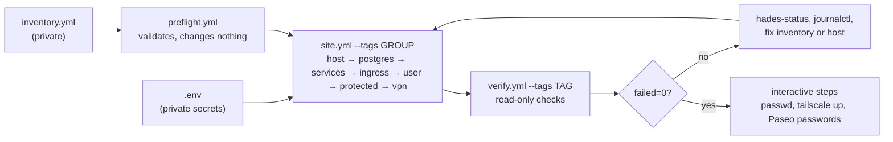
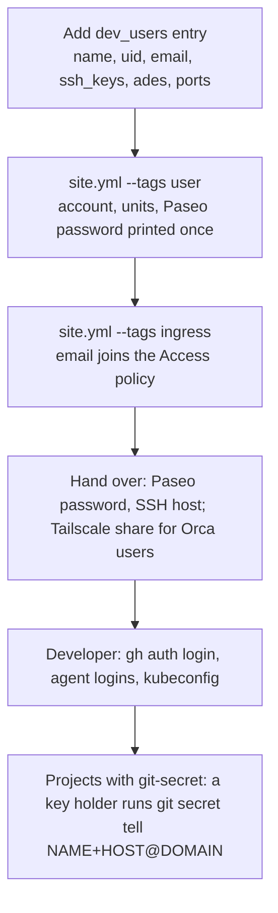
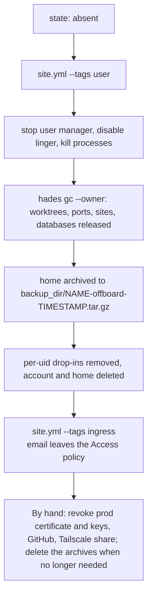

# Server reference

For the operator of a hades server: the Ansible collection `quotedo.hades` in `ansible/`. What developers see is in the [developer guide](developer.md); the CLI in the [CLI reference](cli.md).

## Rules the server enforces

- Multi-tenant: one Linux account per developer, own home, ports, ADE daemon and credentials.
- Among dev accounts, only those with `admin: true` are in group `sudo`, password required. The account Ansible connects with keeps its own sudo.
- Developers cannot install software: tools and packages come from the inventory.
- Agents run as the developer with the developer's own credentials.
- Secrets reach the host over a task's stdin, never through a file on the controller or a command line, except private Hex keys (see Known limits).
- The roles never remove packages, never edit `/etc/ssh`, never restart Docker, never touch workloads listed as protected, never delete inside a home, never delete anything in Cloudflare.

## Requirements

| | |
|---|---|
| Target | Ubuntu 24.04+ or Debian 13+, x86_64; tested on Ubuntu 26.04. VPN role: Ubuntu only. |
| Controller | `ansible-core` 2.17+, `ansible-galaxy collection install -r ansible/requirements.yml`; Go 1.25+ to build the CLI until a release is published. |
| Access | A sudo-capable account on the host, key-only SSH. |
| Cloudflare | The domain as a zone of your account; Zero Trust enabled once (free plan, One-time PIN login). An API token with: Account › Cloudflare Tunnel Edit, Access: Apps and Policies Edit, Access: Organizations Edit; Zone › DNS Edit. |
| Optional | Tailscale (Orca pairing and node sharing); an AmneziaWG config for the intranet VPN. |

## Workflow



```sh
# the CLI binaries for the host (until a release is published)
GOOS=linux GOARCH=amd64 CGO_ENABLED=0 go build -o dist/linux_amd64/ ./cmd/...   # inventory: hades_local_binary_dir: <repo>/dist/linux_amd64

cd ansible
cp inventory.example.yml inventory.yml      # keep it outside git, or in a private site repository
cp .env.example .env && set -a && . ./.env && set +a
ansible-playbook -i inventory.yml playbooks/preflight.yml          # dry check; site.yml runs it again
for g in host postgres services ingress user protected vpn; do
  ansible-playbook -i inventory.yml playbooks/site.yml --tags $g
done
for t in preflight host isolation ops postgres services ingress user ade offboard protected vpn; do
  ansible-playbook -i inventory.yml playbooks/verify.yml --tags $t
done
```

Apply one tag group at a time; each is short and safe to rerun, and a second run reports `changed=0`. Loopback isolation is recomputed after every group (`--skip-tags isolation` leaves it out). Without the Cloudflare variables add `--skip-tags cloudflared`; without `vpn_enabled` the `vpn` group is skipped. From a site repository, install the collection with `ansible-galaxy collection install git+ssh://git@github.com/quotedo/hades.git#/ansible/` and `import_playbook` `quotedo.hades.site` and `quotedo.hades.verify`.

| Tag group | Installs |
|---|---|
| `host` | packages, kernel settings, hades CLI and registry, tool store, agent CLIs, Paseo, Orca, Chrome for Testing, backups, `hades-status`, weekly `hades gc` |
| `postgres` | dev cluster on loopback, `hades.slice` |
| `services` | RabbitMQ (AMQP, MQTT, management) and LocalStack (S3) containers on loopback; Redis when listed |
| `ingress` | Caddy, Cloudflare tunnel, DNS, Access, cloudflared, Tailscale |
| `user` | accounts, resource policy, ADE units, GPG keys, repositories; offboarding |
| `protected` | resource floor and caps for pre-existing workloads |
| `vpn` | AmneziaWG tunnel |

## Inventory

`ansible/inventory.example.yml` is the template. Host variables:

| Key | Type | Meaning |
|---|---|---|
| `ansible_host`, `ansible_user` | | How Ansible reaches the box: a sudo-capable account. |
| `hades_domain` | string | Worktree URLs are `https://<label>.<domain>`; a Cloudflare zone of the account, not a subdomain of one. |
| `hades_label_template` | `!unsafe` string | Label pattern, default `{{project}}-{{name}}`; use `{{project}}-{{user}}-{{name}}` when developers share projects, or two developers on one branch collide. |
| `hades_version` or `hades_local_binary_dir` | | A published release to download, or a directory on the controller holding `hades` and `hades-port` built for linux/amd64. |
| `dev_services` | list | Any of `rabbitmq`, `localstack`, `redis`; empty disables the stack. |
| `tools` | map | Tool → list of exact versions in the shared store; the first is the default. Keys are mise names (`node`, `erlang`, `elixir`, `python`, `go`, `kubectl`, `gh`). `erlang` before `elixir`. |
| `host_extra_packages` | list | Extra apt packages (for example `podman` for rootless containers). Never removed. |
| `agent_clis`, `paseo_version`, `orca_version` | | Installed in the store. `agent_clis` maps a command to an npm package, for example `claude: "@anthropic-ai/claude-code@2.1.310"`; a pinned entry moves everyone, an unpinned one is installed once. |
| `hex_repos` | list | `{name, url, key_env, fingerprint_env}` per private Hex repository; needs `elixir` in `tools`. |
| `access_allow` | list | Extra emails or `@domain` entries admitted by Cloudflare Access, besides every present user's `email`. |
| `access_session` | string | Access session length, default `720h`; set on the application and on the account's Access organization. |
| `tailscale_enabled` | bool | Run `tailscaled`. Default: true when a present user lists `orca`; the example sets `false`, so set it or delete the line. |
| `vpn_enabled`, `vpn_conf_env`, `vpn_probe` | | Intranet VPN: on/off, the environment variable holding this host's config, one `<ip>:<port>` verify must reach. |
| `capped_cpu_weight`, `capped_memory_max` | | Caps for `protected.capped_users` and `capped_units`. |
| `protected` | map | `floor` (guarantee `system.slice` resources), `capped_users`, `capped_units`, `blocked_ports` (ports dev accounts may not reach, such as a production Postgres), `private_homes` (made 0750). |
| `dev_users[]` | list | See below. |

Role defaults can be overridden per host: resource numbers, ports and paths in `roles/host/defaults/main.yml`; Postgres settings in `roles/postgres/defaults/main.yml`; container images and LocalStack buckets in `roles/services/defaults/main.yml`. Resource defaults assume a 128 GB host.

Per developer (`dev_users` entry):

| Key | Meaning |
|---|---|
| `name`, `uid` | Login (`^[a-z][a-z0-9_-]{0,31}$`, unique after dropping characters outside `[a-z0-9]`) and fixed uid ≥ 1000. The role never takes over an existing account with another uid. |
| `state` | `present` (default) or `absent` (offboard). |
| `admin` | `true` on the administrator: group `sudo`, password required. |
| `email` | The address they log in to Cloudflare Access with; required while the Cloudflare variables are set. |
| `ssh_keys` | Public keys for `~/.ssh/authorized_keys`. |
| `ades`, `paseo_port`, `orca_port` | `paseo` and/or `orca`, each with a distinct loopback port. `orca` needs `tailscale_enabled`. |
| `gpg_key` | Generate a passphrase-less GPG key for git-secret; uid `<name>+<inventory host>@<domain>`, public key in `/etc/hades/keys/<name>.asc`. |
| `repos` | Git URLs cloned into the home; private ones after the user's `gh auth setup-git`. |

## Secrets

Exported in the controller's shell before any run (`.env.example` lists them):

| Variable | Used for |
|---|---|
| `CF_ACCOUNT_ID`, `CF_API_TOKEN` | Cloudflare tunnel, DNS, Access (ingress group). Without them: `--skip-tags cloudflared`. |
| `<vpn_conf_env>` (e.g. `AMNEZIA_WG_CONF_BOX`) | The host's AmneziaWG config, multi-line: `export AMNEZIA_WG_CONF_BOX="$(cat box.conf)"`. |
| `<key_env>`, `<fingerprint_env>` per `hex_repos` entry | Private Hex repository keys. |

Generated on the host: GPG keys; Paseo passwords, stored in `~/.config/hades/paseo.env` and printed once in the first apply's output. The dev Postgres credentials are `dev_pg_user`/`dev_pg_password`, default `postgres`/`postgres`.

## Cloudflare

Once: enable Zero Trust on the account. Then, with the two variables exported and every present user carrying an `email`, apply `--tags ingress`. The role reads first and writes only on difference; it never deletes:

| Object | Value |
|---|---|
| Tunnel | `hades-<inventory host name>`, routing `*.<domain>` to Caddy, 404 catch-all. |
| DNS | A proxied `*.<domain>` CNAME to the tunnel. Any other record on that name stops the run. |
| Token | `/etc/cloudflared/token`, root 0600, read by the connector with `--token-file`. |
| Access application | "hades dev sites" on `*.<domain>`, hidden from the launcher, straight to login, `access_session` long. |
| Access organization | Session length set to `access_session` (account-wide). |
| Policy `team` | Allow exactly: present users' `email` + `access_allow`. Offboarding removes an email on the next apply. |

A developer opening a worktree URL enters their email and the PIN Cloudflare mails them. Behind Access, a host name no worktree claims redirects to the apex domain; the dev-tool paths (`/dev`, `/tidewave`, `/phoenix/live_reload`) also require the Access header at Caddy.

## Tailscale

Set `tailscale_enabled: true` (or list `orca` for a user and remove the example's `false`), apply `--tags ingress`, run `sudo tailscale up` on the host once. For each developer, share the machine from the Tailscale admin console with their account; they see the box in their own tailnet. Revoke the share at offboarding. Orca pairs over the Tailscale address; its ports are reachable only on `lo` and `tailscale0`.

## VPN (intranet)

```sh
# 1. export the box's AmneziaWG config from the Amnezia client, edit AllowedIPs to the intranet subnets, remove any DNS line
export AMNEZIA_WG_CONF_BOX="$(cat box.conf)"
# 2. inventory: vpn_enabled: true, vpn_conf_env: AMNEZIA_WG_CONF_BOX, vpn_probe: "<intranet ip>:<port>"
ansible-playbook -i inventory.yml playbooks/site.yml --tags vpn
ansible-playbook -i inventory.yml playbooks/verify.yml --tags vpn
```

| | |
|---|---|
| Installs | `ppa:amnezia/ppa`; `amneziawg` (DKMS kernel module), `amneziawg-tools`, headers for the running kernel. AmneziaWG 2.0 configs are accepted. |
| Writes | `/etc/amnezia/amneziawg/intranet.conf` (root 0600) over stdin; unit `awg-quick@intranet`. A changed config restarts the tunnel. |
| Guards | Preflight and the role reject `0.0.0.0/0`, `::/0`, the `/1` halves and any `DNS =` line. Verify asserts no default route uses the tunnel, a handshake under 180 s, the DKMS module for the running kernel, and `vpn_probe` answering. `sudo hades-status` prints the handshake age. |
| Scope | Host-wide: every account reaches the intranet; identity there comes from each developer's own credentials. |
| Kernel upgrade | The module is built for the running kernel only: after a reboot into a new kernel, apply `--tags vpn` again (verify fails until then). |
| Rollback | `systemctl disable --now awg-quick@intranet`; `apt remove amneziawg amneziawg-dkms amneziawg-tools dkms` and the added `linux-headers-*`; delete `/etc/apt/sources.list.d/amnezia-ppa.sources` and `/etc/apt/keyrings/amnezia-ppa.asc`; `vpn_enabled: false`. |

## Administrator

- `admin: true` → group `sudo`; the distribution's rule asks for the user's password, so an agent cannot escalate. Set it once after the first `--tags user` apply: `sudo passwd <name>` on the host.
- sshd must have `AllowAgentForwarding yes` and, while any administrator exists, `PasswordAuthentication no` and `KbdInteractiveAuthentication no`; otherwise the `user` group stops. Set them in your own sshd drop-in. Hosts using `AllowUsers` need the dev logins added by hand.
- The administrator can read every home.

## Tools

- The store is `/usr/local/share/mise`, root-owned; every user's PATH has its shims. `/etc/mise/config.toml` pins the defaults and turns off auto-install and the fall-through to other binaries.
- The store is exactly `tools`: an apply installs what is listed and removes what is not. Keep an old version listed until every project has moved.
- A project pin the store lacks fails with `Tool not installed for shim: <tool>`.
- `MIX_HOME`/`MIX_ARCHIVES` are set to `~/.mix` in login shells and ADE units; anything else running `mix` (cron, `sudo -u`) must set them too.
- Upgrade: change the version, apply `--tags host,user`. A new default Node reinstalls the agent CLIs and Paseo under it and restarts every Paseo.

## Onboarding



Interactive steps, once per box: `sudo passwd <admin>`; `sudo tailscale up` (before any user lists `orca`). Per developer: Paseo Desktop "Remote SSH" with the printed password; Orca pairing URL from `journalctl --user -u orca.service`; for projects using git-secret, a key holder runs `git secret tell <name>+<inventory host>@<hades_domain>` with the key from `/etc/hades/keys/<name>.asc`.

## Offboarding



Rules: `state: absent` acts only on accounts the role created (group `hades`, matching uid); the entry stays in the inventory (verify expects the archive); a run interrupted before the account is deleted archives again under a new time stamp; offboard archives and the user's nightly archives are never pruned. The archives hold the user's credentials (kubeconfig, GitHub token, agent logins): revoke those, then delete the archives when no longer needed.

## Verify

`verify.yml --tags <tag>`; every tag is read-only except its own probes.

| Tag | Proves |
|---|---|
| `preflight` | the inventory rules on the fixtures in `tests/inventories/` |
| `host` | registry, host config, sudoers, kernel settings, slices, the store holds exactly `tools`, CLIs at their versions |
| `isolation` | the nftables table at boot; a non-dev account is refused on the dev ports |
| `ops` | timers, a backup run, `hades-status`, log caps, Chrome headless |
| `postgres` | dev cluster on loopback, `pg_hba.conf`, credentials |
| `services` | containers on loopback in `hades.slice`, RabbitMQ and LocalStack answer |
| `ingress` | Caddy on loopback, apex redirect, gated paths, cloudflared, the edge redirects to the login, the Access policy equals the inventory |
| `user` | accounts, lingering, resource policy, tools in a login shell, sudo only for administrators, sshd settings, blocked ports, `hades doctor` |
| `ade` | each ADE unit and listener, Paseo's password, no stale units |
| `offboard` | absent users gone and archived, GPG keys exported |
| `protected` | floor, caps, private homes |
| `vpn` | tunnel unit, interface, no default route through it, handshake, DKMS module, probe |
| `acceptance` | with `-e acceptance_user=<throwaway dev user>`: a sample project end to end (`hades up`, URL routing, database, isolation, `hades down`, `gc`, a missing tool version fails loudly). Cleans up after itself. |

`verify.yml --tags reboot -e reboot_test=true` reboots the host and repeats the boot-sensitive tags.

## Operations

| Task | Do |
|---|---|
| Add a tool version | Append to `tools`, apply `--tags host`. |
| Move everyone to a new ADE or CLI version | Change `paseo_version`, `orca_version` or a pinned `agent_clis` entry; apply `--tags host,user`. |
| Upgrade the hades CLI | Change `hades_version`, or rebuild into `hades_local_binary_dir`; apply `--tags host`. |
| Add a system package | `host_extra_packages`, apply `--tags host`. |
| Vanished worktrees | `hades-gc.timer` runs `hades gc` as root weekly; `sudo hades gc` runs it now. |
| Restore a user's ADE state | Stop the user's ADE unit, `sudo tar -xzf <backup_dir>/<user>-<date>.tar.gz -C /home/<user>`, start it. |
| Remove an ADE from a user | Not automated: the user runs `systemctl --user disable --now <ade>.service` and removes `~/.config/systemd/user/<ade>.service`. |
| Roll back an apply | No automatic rollback: revert the inventory and apply again. Removed tool versions are reinstalled; packages the role installed stay. |
| Protected workloads | `protected.floor`; caps named `20-hades-cap.conf` so an operator's `systemctl set-property` (`50-*`) still wins; Docker never restarted; `blocked_ports` enforced in `table inet hades`. |
| Backups | Nightly at 03:30 per user: ADE state and agent logins in `backup_dir`, newest `host_backup_keep` (7) kept, root-only, on the box. |
| What is wrong | `sudo hades-status` (slices, pressure, OOM kills, disk, VPN handshake), `hades doctor` as a user, `verify.yml --tags <tag>`. |

## Known limits

- `AllowUsers` in sshd is not managed; add dev logins by hand.
- A changed open-files limit reaches a running user manager only after it restarts.
- A partly unpacked Chrome for Testing sticks behind its `creates` guard: remove `<chrome_root>/<version>/` and apply again.
- Private Hex keys are passed to `mix` as arguments and show in the process list while it runs.
- Homes are not encrypted; use full-disk encryption at provisioning.
- Isolation hooks the output path only: traffic from a container is not matched.
- `hades-status` embeds the dev Postgres password, which every local account can read anyway.
- The Orca unit has been verified with a headless smoke test, not in daily use.
